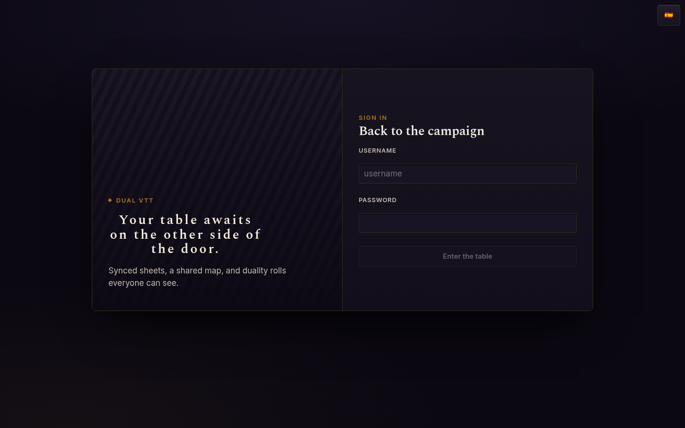
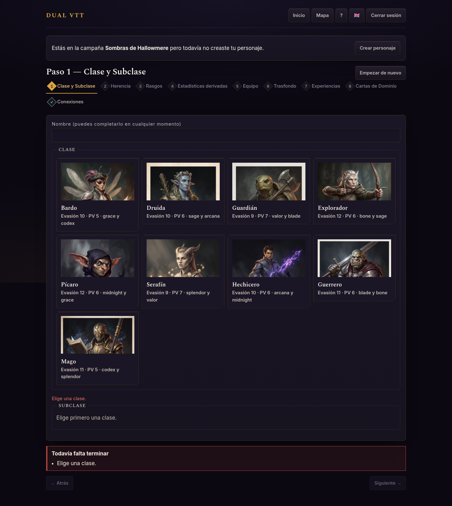
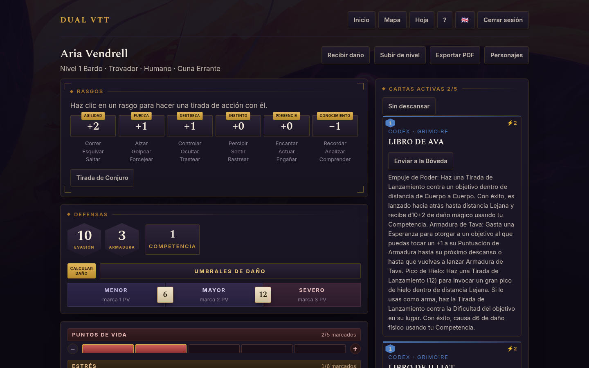
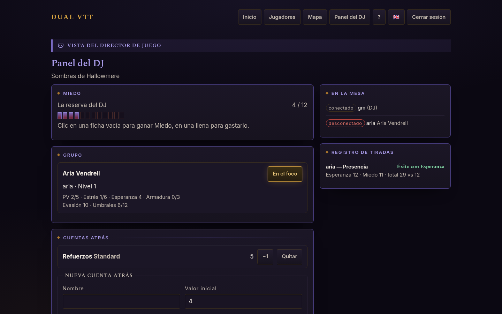
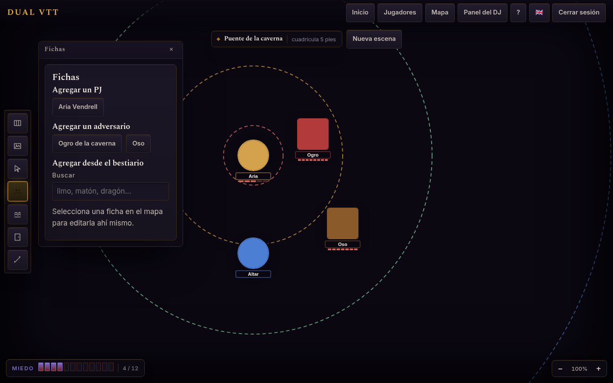
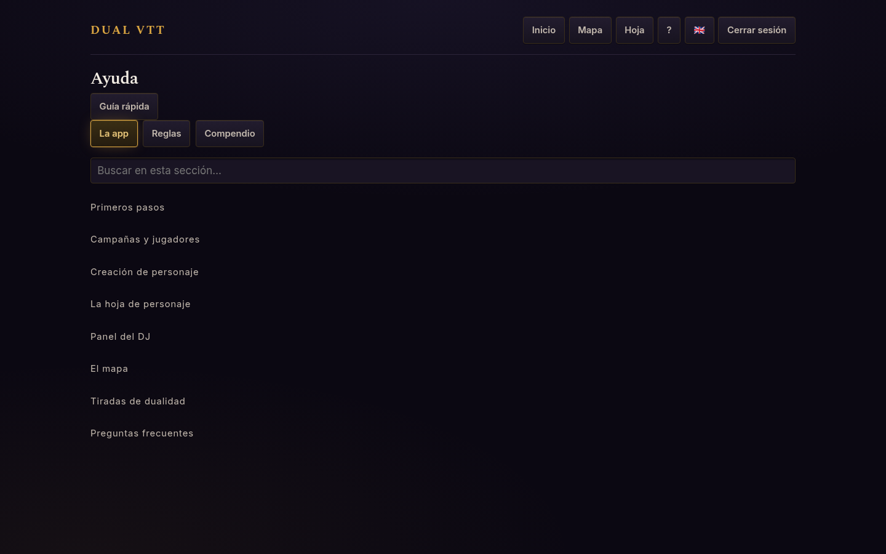

# Dual VTT

Self-hosted VTT, Daggerheart™ Compatible, for running games at my own table. Not
affiliated with or endorsed by Darrington Press. Create a character through
the SRD's nine steps, play off an interactive sheet, run a live campaign room with a
GM panel, and fight over a synced tactical map. Works fully offline too.

Página del proyecto: https://cristosolar.github.io/dual-vtt/

## Screenshots

| Login | Character creation |
|---|---|
|  |  |

| Character sheet | GM panel |
|---|---|
|  |  |

| Tactical map | Help & compendium |
|---|---|
|  |  |

Regenerate with `pnpm dev` running: copy `docs/screenshots/shots.mts` into
`apps/server/` and run `pnpm -F @daggerheart/server exec tsx shots.mts` (needs
`playwright-core` on `NODE_PATH` and a system chromium).

## Packages

| Package | What it is |
|---|---|
| `packages/srd-data` | SRD 2.0 content as typed JSON, one Zod schema per file |
| `packages/rules` | Pure rules functions over that data — no I/O, no global state |
| `packages/character` | Headless 9-step character creation reducer |
| `packages/protocol` | Shared wire types and the pure reducers the server and client both run |
| `apps/server` | Node + Socket.io campaign rooms, authoritative state, JSON snapshots |
| `apps/web` | React app: creation wizard, character sheet, GM panel, tactical map |

## Commands

```sh
pnpm install
pnpm dev         # server (:4000) and web (:5173) together
pnpm dev:web     # web only — the app works with the server stopped
pnpm build       # typecheck + production bundle
pnpm typecheck   # tsc, strict, across every package
pnpm test        # vitest
pnpm validate    # parse every JSON against its schema; fails the build on mismatch
```

Requires Node 20+ and pnpm.

## Run it on your machine

```sh
git clone https://github.com/CristoSolar/dual-vtt.git
cd dual-vtt
pnpm install
pnpm dev
```

Open http://localhost:5173 and sign in as `gm` / `gm` (set `GM_USERNAME` /
`GM_PASSWORD` to change the first account; you are asked to change the password on
first login anyway). The GM lands on two choices: **My campaigns** (active, paused
and finished, each with a page for its story, notes, the monsters you plan to use,
and its players) and **My players** (create accounts, invite them, reset passwords).
A paused or finished campaign lets only the GM sit down. A player signs in to two
choices: **My characters** (create as many as they like, link one to a campaign) and
**My campaigns** (accept invitations, enter a table). Everything is saved under `.data/` next to
the server — back that folder up if you care about the campaign.

To play with people who are not on your network:

```sh
pnpm -F @daggerheart/server host   # builds the web app and serves it from :4000
```

Then, at the bottom of **My campaigns**, click **Generate link for players**. The server opens a Cloudflare
quick tunnel and shows a public URL your players can open. The tunnel lives only
while the server runs. Anyone with the URL reaches the login screen, so use real
passwords.

The app is bilingual; the flag in the top bar switches between English and Spanish.
`?` opens the help: an app guide, a rules primer, and a compendium of the SRD.

## Notes

- Every rules function takes an injectable `rng: () => number`, so tests are
  deterministic and nothing reads global state. `seededRng` and `scriptedRng` are
  provided for that.
- Dice are structured (`{ count: 1, die: 8, modifier: 3 }`), never strings.
  `formatDice` renders them for display.
- Rules text is stored verbatim from the SRD, including its own typos.
- `packages/srd-data/extract/` holds the scripts that generate the JSON from the
  SRD PDF; see the README there to re-derive it against a newer release. They are
  the only way the data changes: every file is extracted, never hand-edited.
- The web app holds no game logic: components render state and dispatch actions,
  while every rule lives in `rules` or `character`. State transitions are pure
  functions in `apps/web/src/state`, so they can later be replayed over a socket.
- The app is bilingual (English / Spanish). The choice is per device, stored in
  `localStorage`, and applies to UI text and SRD content alike. SRD data ships in
  both languages under `packages/srd-data/data/{en,es}` with identical ids; the web
  reads it through `srd()`, which follows the active locale.
- Help lives at `/help`: an app guide, a short rules primer (hand-written, with
  SRD page references), and a compendium that browses the bundled SRD data in
  the active language. A first-run guide opens once per account per device.
- Characters are stored on the server, in the account's library, so they follow the
  player to any device. A character is linked to at most one campaign at a time, and
  a player has at most one per campaign. While linked, the campaign's copy is the live
  sheet; unlinking writes it back to the library. Only an unfinished creation draft is
  kept in the browser's `localStorage`. Characters saved in a browser by an older
  version can be imported from **My characters**.
- In a campaign the **server is authoritative**: clients send intents, never results.
  A client asks to `takeDamage`; the server computes the HP with `applyDamage` and
  broadcasts it. Dice are rolled server-side from a per-room seed, so every roll is
  reproducible and auditable from the log.
- Permissions are enforced server-side: a player may only mutate their own character,
  and only the GM may touch Fear, spotlight, countdowns, adversaries, or the
  environment.
- Campaigns, accounts and character libraries live in memory and are snapshotted to
  `.data/campaigns.json`, `.data/users.json` and `.data/characters.json` every few
  seconds; losing `.data/` loses the campaigns and the characters, so back it up. On
  first boot with this version, every character already in a campaign is filed into
  its owner's library, linked to that campaign.
- The map has no grid by default: distances are reported as Daggerheart's range
  bands (Melee / Very Close / Close / Far / Very Far), with the SRD's optional
  1-inch-grid rule available per scene. The band maths lives in
  `packages/protocol/src/ranges.ts` and is tested there, not in a canvas component.
- Players are sent only the active scene, without GM-only tokens, and fog is
  transmitted as the list of *revealed* cells — an unrevealed region never reaches a
  player's browser at all.
- Map images are uploaded to `.data/uploads` and validated by their magic bytes, not
  by the content type the browser claims.

## Licensing

Source code: MIT (see `LICENSE`).

Game content: this product includes materials from the Daggerheart System Reference
Document 2.0, © Critical Role, LLC, under the terms of the Darrington Press Community
Gaming (DPCGL) License — https://www.darringtonpress.com/license/. More information
at https://www.daggerheart.com.

The English data reproduces the SRD text as printed. The Spanish data is an unofficial
translation made for this project, and is the only modification of the licensed
material; there are no previous modifications by others. The SRD PDF itself is not
committed, and Campaign Frames are not reproduced, since the licence allows sharing
those only as actual play.

Dual VTT is an independent fan-made tool for private play, not sold or monetized, and
not affiliated with or endorsed by Darrington Press or Critical Role. Daggerheart is a
trademark of Critical Role, LLC. The same notice is shown in the app under **Help →
Licence**. Full text in `NOTICE.md`.
